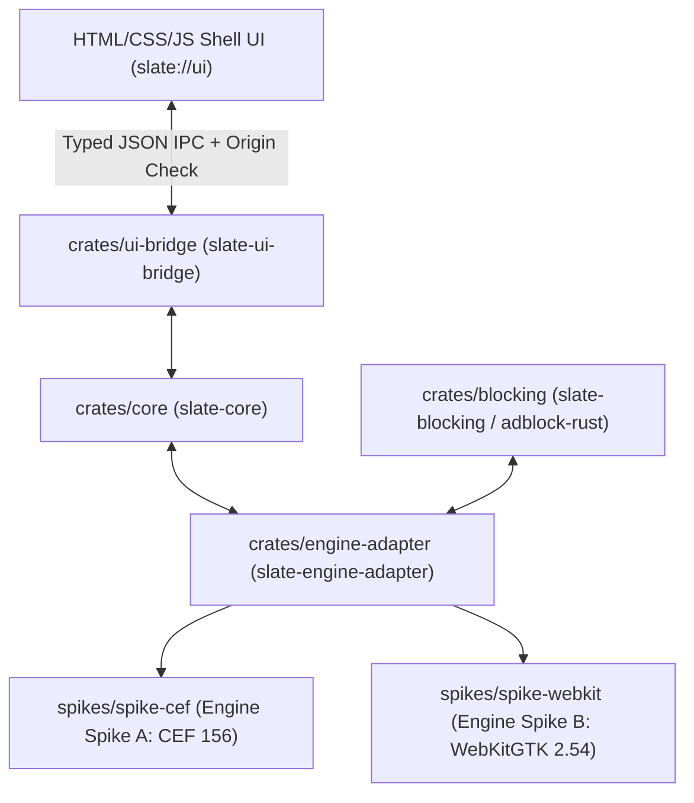

# Slate Architecture

Slate is a lightweight, privacy-first desktop browser with a Rust core and Brave-grade ad/tracker blocking (`adblock-rust`).
Linux (Arch first) is the primary target for v1, with platform- and engine-specific code isolated behind `slate-engine-adapter` so Windows and Android can be added cleanly later.

## Workspace Layout

### Crates

1. **[`crates/core`](file:///home/earl/Desktop/Slate/crates/core/src/lib.rs) (`slate-core`)**
   - `#![forbid(unsafe_code)]`
   - Owns browser state: `TabManager`, `TabState`, `TabId`, `ScrollPosition`, and `TabLifecycleState`.
   - Implements the **Tab Sleeping / Suspension** policy: tracks per-tab last-active timestamps, excludes focused tabs and tabs playing audio or video, saves URL/title/scroll position before discarding the underlying engine view, and restores state on focus.

2. **[`crates/blocking`](file:///home/earl/Desktop/Slate/crates/blocking/src/lib.rs) (`slate-blocking`)**
   - `#![forbid(unsafe_code)]`
   - Wraps Brave's `adblock` (`0.13.5`, multi-threaded `Send + Sync`) inside an atomically swappable `Arc<RwLock<Engine>>`.
   - Implements all 7 required ad/tracker blocking capabilities:
     1. **Network request blocking** with EasyList, EasyPrivacy, and uBlock-style rules.
     2. **Cosmetic filtering** (per-hostname and generic class/ID CSS selector hiding via `url_cosmetic_resources` and `hidden_class_id_selectors`).
     3. **Scriptlet injection** (`##+js(...)` uBlock resources such as `set-constant`, `json-prune`, and `abort-on-property-read` for YouTube and anti-adblock defeat).
     4. **Third-party cookie and storage blocking** using `adblock-rust`'s embedded Public Suffix List domain resolver plus iframe `localStorage`/`sessionStorage` isolation.
     5. **HTTPS upgrades** (HTTPS-first navigation and subresource upgrade with automatic fallback host tracking when a server fails TLS/connect).
     6. **Tracking-parameter stripping** (`utm_*`, `fbclid`, `gclid`, `msclkid`, `mc_eid`, `twclid`, `yclid`, etc., plus `$removeparam` filter rules).
     7. **Custom user filter lists** (pasted rules, local file, or remote URL) with background thread compilation (`update_lists_in_background`) and FlatBuffer `.dat` binary cache serialization (`serialize_cache` / `deserialize_cache`) so startup is never slowed down.

3. **[`crates/ui-bridge`](file:///home/earl/Desktop/Slate/crates/ui-bridge/src/lib.rs) (`slate-ui-bridge`)**
   - `#![forbid(unsafe_code)]`
   - Defines `UiCommand` and `CoreEvent` messages between the HTML/CSS/JS shell UI and `slate-core`.
   - Enforces origin verification (`ALLOWED_UI_ORIGINS` only; web origins are rejected) and `INTERNAL_UI_CSP` (`default-src 'none'; script-src 'self'; style-src 'self'; ...`) to prevent remote code execution or `eval()` in internal pages.

4. **[`crates/engine-adapter`](file:///home/earl/Desktop/Slate/crates/engine-adapter/src/lib.rs) (`slate-engine-adapter`)**
   - `#![forbid(unsafe_code)]`
   - Defines the `BrowserEngineAdapter` trait and `EngineCapabilityReport`.
   - This is the **only** architectural boundary that knows which rendering engine is active.

5. **Phase 0 Engine Spikes**
   - **[`spikes/spike-cef`](file:///home/earl/Desktop/Slate/spikes/spike-cef/src/main.rs) (`slate-spike-cef`)**: Rust shell + Chromium Embedded Framework (`cef = "156.4.0+156.0.26"`, Chromium 156) using CEF Views (`window_create_top_level` + `browser_view_create`), `RequestHandler`, `ResourceRequestHandler`, `CookieAccessFilter`, `LoadHandler`, and `DisplayHandler`.
   - **[`spikes/spike-webkit`](file:///home/earl/Desktop/Slate/spikes/spike-webkit/src/main.rs) (`slate-spike-webkit`)**: `#![forbid(unsafe_code)]` Rust shell + WebKitGTK (`webkit2gtk = "2.0.2"` / `webkit2gtk-4.1 2.54.2`) using `WebContext` (bubblewrap sandbox enabled), `UserContentManager`, `CookieManager`, and `WebView`.

## Security Boundaries & `unsafe` Audit

- **Sandbox**: Enabled in both engines (`context.set_sandbox_enabled(true)` in WebKitGTK; `Settings { no_sandbox: 0, .. }` in CEF).
- **Internal UI pages**: No remote code loading; locked down with `INTERNAL_UI_CSP`; IPC commands reject any non-`slate://` origin.
- **`unsafe` policy**:
  - `slate-core`, `slate-blocking`, `slate-ui-bridge`, `slate-engine-adapter`, and `slate-spike-webkit` all enforce `#![forbid(unsafe_code)]`.
  - `slate-spike-cef` contains zero manual `unsafe` blocks in our code, but invokes the `cef` crate's `wrap_*!` macros (`wrap_app!`, `wrap_client!`, `wrap_request_handler!`, etc.), which expand internally to `unsafe` C reference-count calls (`RcImpl` / `add_ref`).

## Fingerprinting Protection Scope

Because engine-level C++ patches are not used, fingerprinting protection is injected at `document-start` via [`build_document_start_script`](file:///home/earl/Desktop/Slate/crates/blocking/src/lib.rs#L424-L505):
- **What it protects against**: Basic JS-level fingerprinting of `navigator.hardwareConcurrency` (normalized to 4), `navigator.deviceMemory` (normalized to 8), `navigator.doNotTrack` / `navigator.globalPrivacyControl`, 2D Canvas `toDataURL` readback hashes (deterministic LSB bit flip), and third-party iframe `localStorage`/`sessionStorage` tracking.
- **What it does NOT protect against (explicit limitations)**:
  - Network/TLS/HTTP2 fingerprint (JA3/JA4, ALPN, TCP/IP stack parameters).
  - WebGL shader timing, GPU renderer string (`UNMASKED_RENDERER_WEBGL`), and WebGPU adapter limits.
  - Font enumeration via CSS layout bounding-box measurement (`offsetWidth` / `getBoundingClientRect`).
  - `iframe` clean-realm bypasses if a script synchronously creates an `about:blank` iframe and reads unpatched `contentWindow.HTMLCanvasElement` before `MutationObserver` or frame hooks run (mitigated in CEF via `CefRenderProcessHandler::on_context_created` / CDP `Page.addScriptToEvaluateOnNewDocument` across all frames).
